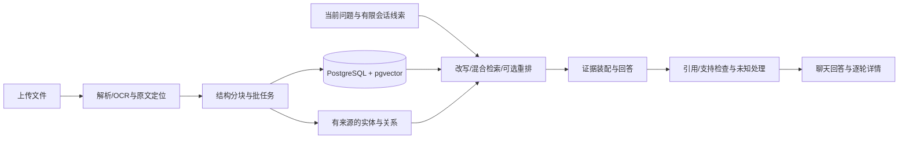

# KnowFlow RAG

一个可本地部署的中英文文档问答项目，界面名称为 **FinCite**。核心检索、结构分块、来源追踪和图增强流程独立实现；PDF版面分析和模型能力使用成熟组件/API。

**v0.1.0 是研究/开发原型。** 当前目标是别人能安装、运行、测试和检查依据。工程测试、模型评审、来源标记校验不等于答案准确率；没有独立标注时保持 unknown，不承诺图谱一定优于文本检索。

## 首版能做什么

- 注册/登录、按用户隔离知识库，上传 PDF、DOCX、Markdown、TXT、CSV、XLSX。
- 持久批量摄入，结构/token分块、解析报告、切片/原文/原页检查；PDF可选本地Docling/OCR。
- PostgreSQL + pgvector 语义检索、关键词检索、RRF混合检索、可选重排和有限文内引用展开。
- 带引用的正常Markdown回答、无证据拒答；支持安全渲染表格、代码和Mermaid图表。
- 持久多轮会话、有限指代消歧与候选发现；每轮重新查证，旧回答不作为文档事实。
- 文档总结、实验性有来源图谱、任务检查点、显式启用的长期记忆和逐轮诊断。
- 离线评测账本、召回/排序/来源诊断及软件回归测试。只分发自写合成控制，不能把它们当独立质量基线。

详细边界见[首版范围](docs/release-scope.md)、[已知问题与后续路线](docs/roadmap.md)。

## 快速开始

需要 Docker Desktop/Engine + Compose（支持可选env_file的版本，建议2.24+），以及Python 3.12或3.13执行初始化脚本。真实问答需要兼容OpenAI聊天协议的模型API和embedding API。使用结构化PDF/OCR时，还会下载较大的可选Docling镜像及模型；CPU模式限制为4GB内存，复杂PDF较慢。

在源码根目录执行（PowerShell、macOS/Linux终端均可）：

```text
python scripts/init_env.py
```

在本地编辑生成的 `.env`，填入：

| 配置 | 用途 |
|---|---|
| `LLM_API_KEY / LLM_BASE_URL / LLM_MODEL` | 聊天模型；复杂任务可配置 `LLM_COMPLEX_MODEL` |
| `EMBEDDING_API_KEY / EMBEDDING_BASE_URL / EMBEDDING_MODEL` | 文档及问题的向量表示，和聊天模型分开 |
| `EMBEDDING_DIMENSIONS` | 必须与所选embedding接口实际返回维度一致 |
| `RERANK_API_KEY / RERANK_BASE_URL / RERANK_MODEL` | 可选重排；未配置时不要选择重排策略 |

JWT密钥由初始化脚本随机生成，不打印，也不会覆写已有配置。模型ID和地址以供应商账号实际支持为准；示例值不是对任何兼容接口的能力承诺。先使用同一个embedding模型与维度建库；换embedding后旧索引不会自动转换。

```text
docker compose up -d --build
```

打开 [聊天页面](http://localhost:8080/)，注册自己的账号，新建知识库，上传文档；状态变为就绪后提问。可先上传 `evaluation/corpus/` 中的合成Markdown文件。API说明在 [Swagger](http://localhost:8000/docs)。默认端口只绑定本机，首次启动自动执行数据库迁移。

需要结构化PDF/OCR时，启动同一项目的覆盖配置：

```text
docker compose -f compose.yml -f compose.pdf.yml up -d --build
```

这条命令对后续PDF启用Docling；已经入库的文档不会静默重建。原生PDF路径适合可提取文字的文件，不等于OCR。更多说明见[PDF解析](docs/pdf-parsing.md)。

停止服务但保留数据库和上传卷：

```text
docker compose stop
```

不要删除数据卷来解决启动问题。日志、备份和升级步骤见[运维说明](docs/operations.md)。

## 不填API key也能检查安装

提供独立的软件契约测试栈，使用确定性本地stub，**不是语言模型，也不验证理解/准确率**：

```text
docker compose -p knowflow_contract -f compose.smoke.yml up -d --build
docker compose -p knowflow_contract -f compose.smoke.yml port frontend 80
```

第二条命令给出随机本机端口。把地址填给 `scripts/smoke_test.py --base-url http://127.0.0.1:端口 --out smoke-result.json`。它验证注册、隔离、摄入、引用、持久聊天和图谱协议。不要将这个脚本指向自己的日常知识库服务。此测试栈使用独立数据库与上传卷，不读取真实 `.env`，不调用外部模型。

## 开发与测试

后端支持Python 3.12/3.13；前端构建使用Node 24.15.0、pnpm 11.25.0。前端Docker多阶段构建会自行安装锁定依赖并生成产物，无需本机已有 `dist/` 或 `node_modules/`。

```text
python -m pip install uv==0.13.5
uv sync --locked --extra dev
docker compose up -d db
uv run --locked --extra dev python scripts/run_tests.py -q -rs
uv run --locked --extra dev ruff check backend migrations scripts
```

隔离测试运行器新建随机测试数据库，执行迁移/pytest，最后仅删除该测试库；不向现有应用库写测试数据。数据库角色需要CREATE DATABASE权限。不要直接把pytest指向正在使用的应用数据库。

```text
cd frontend
pnpm install --frozen-lockfile --ignore-scripts
pnpm test
pnpm build
```

离线测试主要验证软件与协议，不调用付费模型。M2检查使用自写数字/标注夹具；公开包明确跳过2项需要未分发历史资料的归档核对，不能称这些历史核对已在公开包通过。详细范围见[测试说明](docs/testing.md)。GitHub Actions配置随源码提供；是否远端通过，以实际仓库运行结果为准。

## 架构与关键选择



PostgreSQL同时保存账号、会话、文档元数据、来源、向量、关系和记忆。当前使用精确向量查询，没有把未经测量的HNSW/分布式存储当成首版要求。embedding输入包含章节/表注上下文；引用保留原文，不用自动生成说明替换证据。LightRAG是研究参考，不是运行依赖或功能对齐承诺。

## 已知限制

- 规范PDF也可能有阅读顺序、跨栏标题或表格错误；跨页续表、复杂图形关系和坏页自动恢复尚不完整。
- 检索分数与模型相关性等级不是校准过的正确概率；引用存在不能证明所有断言正确。
- 总结的 `citation_checked` 只检查来源标记，未逐句语义复核；仅覆盖已解析文字，超窗口时可能只完成部分分段。
- 候选发现有范围和预算限制；单个候选不代表全库唯一；无字段说明的数字不能猜成学号。
- 任务/长期记忆是显式线索与偏好，不能覆盖当前用户条件或替代文档事实。没有任意业务的通用记忆正确性保证。
- 没有完整独立金标、生产负载测试或跨文档版本裁决/任意计算承诺。删除知识库/聊天没有回收站。

## 发布与贡献

首版先完成可复现的软件闭环，后续依次推进评测、检索/多轮稳定性、常见复杂文档、图消融和跨文件版本/计算。[贡献说明](CONTRIBUTING.md)、[安全边界](SECURITY.md)、[第三方说明](THIRD_PARTY_NOTICES.md)。原始项目代码与合成控制采用MIT许可；第三方库、模型和外部文档保留各自许可。
